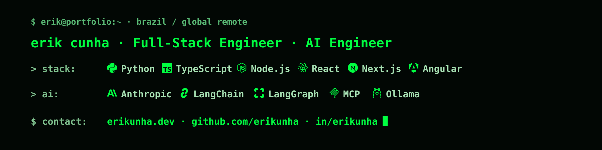

  

  

  
  &nbsp;
  
  &nbsp;
  
  &nbsp;
  

  
  &nbsp;
  
  &nbsp;
  

  
<h2>📘 My Top Open Source Projects</h2>

  

    
    
  

  

    
    
  

  

  
<h2>📕 Top Projects I've Contributed To</h2>

  

    
    
  

  

    
  

  
<h2>🛠️ My Stack</h2>

  <h3>💻 Languages</h3>
  

    
    
    
    
    
    
    
  

  <h3>🤖 AI &amp; agents</h3>
  

    
    
    
    
    
    
    
    
    
  

  <h3>🗄️ Backend &amp; data</h3>
  

    
    
    
    
    
    
    
    
    
  

  <h3>🖥️ Product engineering</h3>
  

    
    
    
    
    
    
    
    
    
    
    
    
    
    
    
    
    
  

  <h3>🚀 Platform, delivery &amp; quality</h3>
  

    
    
    
    
    
    
    
    
    
    
  

  
<h2>📊 Stats and Activity</h2>

  <h3>🔥 Streak Stats</h3>

  

    
  

  
🔥 Get streak stats for your profile at <a href="https://git.io/streak-stats">git.io/streak-stats</a>

  <h3>💻 GitHub Profile Stats</h3>

  

    
    
  

  
<i>Note: Top languages is only a metric of the languages my public code consists of and does not reflect experience or skill level.</i>

  <h3>📈 Activity Graph</h3>

  

    
  

  <h3>⚡ Recent GitHub Activity</h3>

<!--START_SECTION:activity-->
1. 💪 Opened PR [#405](https://github.com/erikunha/portfolio/pull/405) in [erikunha/portfolio](https://github.com/erikunha/portfolio)
2. 🎉 Merged PR [#404](https://github.com/erikunha/portfolio/pull/404) in [erikunha/portfolio](https://github.com/erikunha/portfolio)
3. 💪 Opened PR [#404](https://github.com/erikunha/portfolio/pull/404) in [erikunha/portfolio](https://github.com/erikunha/portfolio)
4. 🎉 Merged PR [#403](https://github.com/erikunha/portfolio/pull/403) in [erikunha/portfolio](https://github.com/erikunha/portfolio)
5. 💪 Opened PR [#403](https://github.com/erikunha/portfolio/pull/403) in [erikunha/portfolio](https://github.com/erikunha/portfolio)
<!--END_SECTION:activity-->

